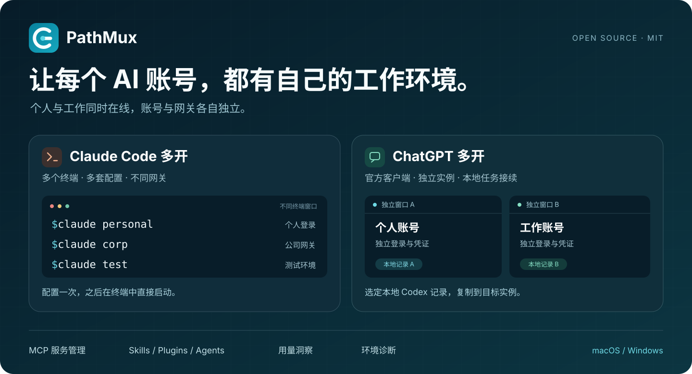
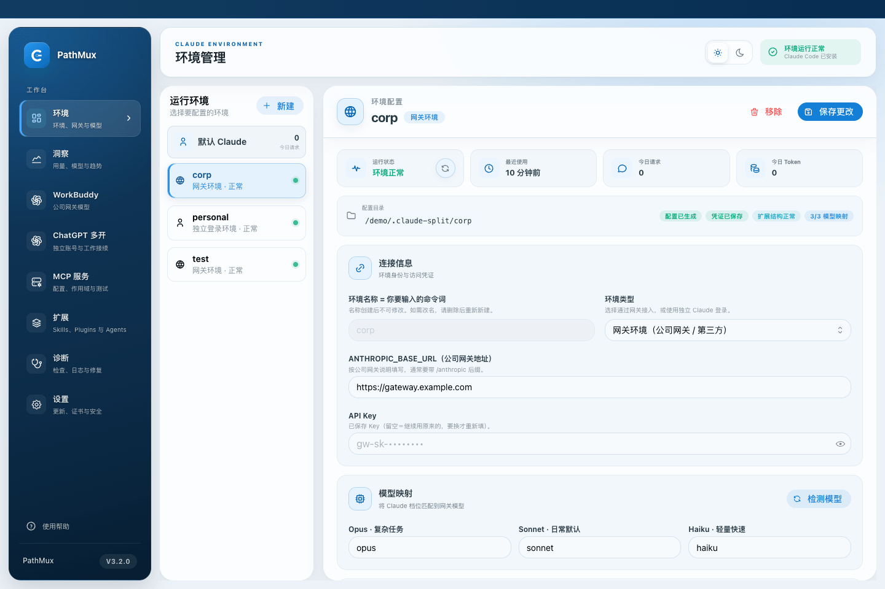
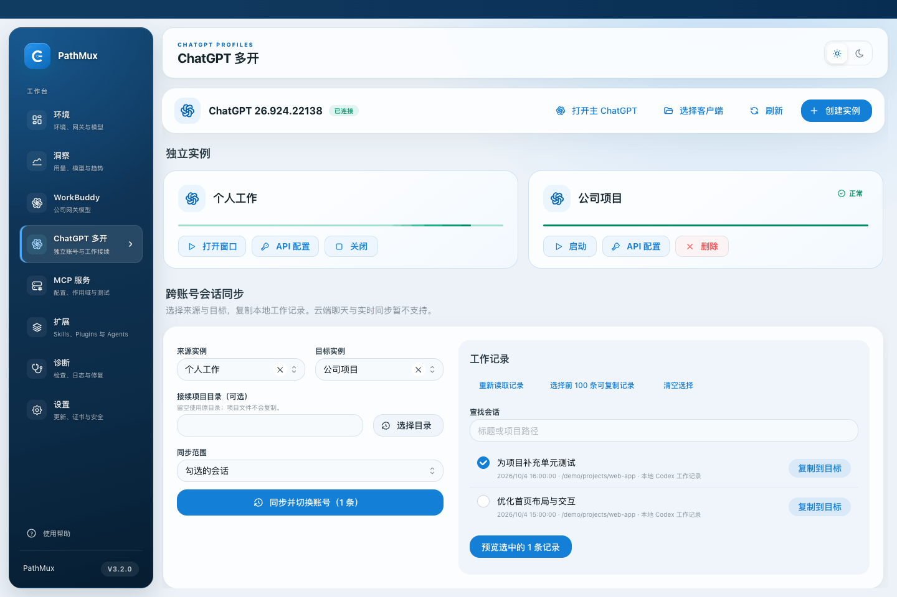

<div align="center">


# PathMux

### Claude Code 多开 · ChatGPT 多开

**一台电脑，多个账号，各自的工作环境，同时在线。**

[](https://github.com/Hollelihanqi/new-claude/releases/latest) [](LICENSE) 

[下载安装](https://github.com/Hollelihanqi/new-claude/releases) · [Claude Code 多开](#claude-code-多开) · [ChatGPT 多开](#chatgpt-多开) · [快速上手](#快速上手) · [反馈建议](https://github.com/Hollelihanqi/new-claude/issues)



</div>

PathMux 是一款支持 **macOS 与 Windows** 的开源桌面工具，让 **Claude Code 多环境并行**与 **ChatGPT 官方客户端多开**集中在一处管理。个人账号、工作账号与公司网关各有自己的配置，日常继续使用熟悉的终端和官方客户端。

## 为什么选择 PathMux？

- **多个账号，同时工作**：Claude Code 在不同终端使用独立环境，ChatGPT 在多个官方窗口分别登录。
- **配置各自保存**：按环境或实例管理登录状态、网关地址与模型，减少反复退出登录和修改配置。
- **换账号，接着做任务**：将选定的本地 Codex 工作记录复制到目标实例，在独立副本上继续。
- **常用工具统一管理**：MCP 服务、Skills、Plugins、Agents、本地用量与诊断，一处查看和维护。

## Claude Code 多开

**同一项目，不同终端，各用各的账号与网关。**

创建网关环境或独立登录环境，在各自的终端中启动。每条命令独立选择环境，PathMux 无需一直开着。

```bash
# 先在 PathMux 中创建对应环境，再在不同终端分别运行
claude             # 默认 Claude
claude personal    # 个人独立登录环境
claude corp        # 公司网关环境
```

每个网关环境可单独设置地址、API Key 和 Opus / Sonnet / Haiku 模型映射；受管理环境使用独立配置目录，默认 Claude 配置保持原样。



## ChatGPT 多开

**多个账号，多个官方窗口，分别保留登录与工作状态。**

PathMux 复用本机安装的兼容官方 ChatGPT 客户端，为每个实例准备独立的桌面数据、Codex 配置、凭证与会话数据库目录。

- **账号独立登录**：为个人与工作账号分别创建实例，同时打开使用。
- **窗口集中管理**：创建、启动、打开窗口、关闭与检查实例。
- **API 按实例配置**：独立设置 API 地址、Key 与模型，用于客户端的 Codex 工作能力，也可切回账号登录。
- **本地任务接续**：按会话、项目或全部本地会话选择记录，预览后复制到目标实例；来源保留，目标后续进展独立保存。



<p align="center"><sub>以上截图为实际前端界面，使用虚构账号、环境与演示数据。</sub></p>

> **兼容与验证**：需要具备独立数据目录能力的官方 Codex / Electron 桌面客户端，旧版原生客户端不支持。macOS 已有双账号多开实测记录，Windows 真机登录与窗口流程仍待验证，详见[验证记录](docs/testing/ChatGPT多开-Windows测试交接-2026-09-28.md)。
>
> **接续范围**：支持本地 Codex 工作记录的按次复制，不包含普通 ChatGPT 云端聊天、云端任务或实时双向同步。账号凭证、工具授权和项目文件不随记录复制；两个实例使用同一项目目录时，仍会读写同一份文件。

## 快速上手

先从 **[GitHub Releases](https://github.com/Hollelihanqi/new-claude/releases)** 下载适合系统与芯片架构的安装包：macOS 使用 `.dmg`，Windows 使用 `.msi` 或 `.exe`。

### 使用 Claude Code 多开

1. 安装 [Claude Code](https://code.claude.com/docs/en/setup)，确认终端可以运行 `claude`。
2. 在「环境」页面新建网关环境或独立登录环境，填写名称与所需配置，点击「保存更改」。
3. 按提示完成终端接入，在新终端中运行 `claude <环境名>`。Windows 使用 PowerShell；独立登录环境按提示登录。

### 使用 ChatGPT 多开

1. 安装兼容的官方 ChatGPT 客户端并正常打开一次。
2. 进入「ChatGPT 多开」，确认客户端已识别；未找到时点击「选择客户端」。
3. 创建第一个实例，启动后在官方窗口完成登录；为其他账号重复创建实例。
4. 需要接续本地任务时，选择来源和目标，在左侧搜索、勾选会话，在右侧核对正文，再点击「复制所选会话」并确认。默认只创建独立副本；需要继续工作时，勾选「复制完成后打开目标会话」。项目范围、全部会话和接续目录位于「更多设置」中。

公司网关使用自签名证书时，可在「设置」中导入管理员提供的 CA 证书。更多操作说明见应用内「使用帮助」。

## 本地开发

基于 **React + TypeScript + Tauri 2 + Rust**。准备 Node.js、pnpm、Rust 及对应平台的 Tauri 构建依赖后：

```bash
pnpm install
pnpm tauri dev
```

构建安装包：`pnpm tauri build`。

## 参与和支持

欢迎 **Star**，或分享给需要 Claude Code / ChatGPT 多开的朋友。遇到问题或有新想法，欢迎提交 [Issue](https://github.com/Hollelihanqi/new-claude/issues) 或 Pull Request。

[MIT License](LICENSE) · PathMux 是独立开源项目，与 Anthropic、OpenAI 无官方隶属关系。账号订阅与 API 费用由对应服务提供方收取。
