# PathMux 扩展中心：三套完整交互设计

日期：2026-10-19

交付范围：Plugins 功能，三套交互方案、12 张效果画板、48 个关键界面与状态。Skills 和 Agents 仅保留导航位置。

打开 index.html 可按方案浏览；点击状态卡可放大单帧，并沿按钮分支查看后续状态。每张画板按左上、右上、左下、右下阅读。图片保留原文件，查看器放大不改变原图内容。

## 方案的区别

|方案|主要入口|状态规则|适用任务|
|---|---|---|---|
|A 单环境独立管理|当前环境插件列表|环境独立，复制是一次性的|日常安装、启停、排障|
|B 跨环境批量管理|插件 × 环境对照表|环境独立，每次明确目标|比较差异、集中配置、批量维护|
|C 公共配置与环境例外|公共期望 + 环境实际 + 管理来源|跟随项持续同步，独立项排除|长期维持统一配置并保留例外|

A、B 采用同一独立管理规则，但以不同任务组织界面；可以作为同一产品的两个视图。C 是另一套持续管理规则，不能把它的跟随语义混进 A、B 的一次性操作中。

## 共同交互约定

1. 顶部范围、按钮文案与实际写入范围一致。当前环境操作不能静默影响其他环境。
2. 安装状态、启用状态、实际版本与运行时是否生效分别表达。设计稿采用“对新会话生效”的保守约定；落地时必须依据实际运行机制调整提示，不能只保存配置就显示当前会话已生效。
3. 安装/更新经历下载、写入、验证；验证完成前显示处理中。关闭抽屉不取消已提交任务，列表保留执行状态。
4. 提交前的取消无副作用。提交后若不支持可靠取消，则使用“后台继续/关闭”，避免虚假的取消承诺。
5. 同一环境、同一插件执行期间避免并发修改。第二次操作应展示正在执行的任务。
6. 批量操作先明确目标并预览实际变化，结果逐环境展示。已处于目标状态的项标为无需修改；不重复执行。
7. 部分失败不伪装成整体成功。成功项保留，失败项展示实际状态和原因，仅重试失败项；重试前重新验证环境条件。
8. 图中的更新失败保留旧版，要求实现支持校验后切换和失败保留。若现有机制无法保证，就必须展示真实损坏/修复状态，不得照搬“原版本可用”的成功承诺。
9. 卸载使用明确的环境名称和影响范围；取消不写入。卸载后提供重新安装，不假设即时撤销。
10. 搜索无结果不同于环境无插件。环境不可访问时显示上次已知状态与待确认标记，停止向该环境写入；健康环境仍可管理。
11. 外部工具改变配置后，重新读取实际状态；预览已过期时重新核对，不能用陈旧预览覆盖新状态。
12. 焦点应进入打开的对话框、关闭后回到触发按钮；Tab 顺序与视觉顺序一致。状态提示使用图标和文字，不能只靠颜色。画板是视觉设计，不代表上述键盘/辅助技术行为已完成实测。

## 复用画面的规则

画面编号是交互状态模板。通过“重新启用”“重新安装”“从其他环境复制”“新环境接入”等入口复用时，必须继承本次插件、环境、版本和当前结果；不能因为跳转到示例帧就重置数据。查看器的按钮用于演示流转，图片中的示例数据不会动态改写。

A03/A04 的进度和完成模板也用于安装失败后重试；失败文案、实际状态和恢复入口沿用 A08/A11 的错误处理原则。B04/B05 用于执行进度与逐环境结果。C03/C04 用于首次接入、添加公共插件后的持续同步进度与结果。

## C 方案的额外规则

- 公共配置中的每个插件包含安装意图、版本和启用状态。插件级“单独设置”使这三项全部退出自动覆盖，避免含糊的部分跟随。
- 状态相同不意味着存在跟随关系。管理来源由明确设置决定，界面必须标记。
- 公共期望保存成功与全部环境同步成功是两件事；分别记录、分别显示。
- 同步失败仍然保留跟随关系，不自动转成单独管理。未完成的环境显示期望与实际偏差。
- 恢复跟随先预览立即变化，再说明后续持续关系；可能导致启用、版本切换或安装变化。
- 公共移除保留明确的“不安装”意图，同步移除跟随项；独立项不受影响。
- 新环境默认独立管理。主动选择跟随后，先预览将安装的插件与版本，再创建并同步；现有环境不变。

## 设计数据与实现前提

示例插件 ecc、rust-analyzer-lsp、superpowers 来自用户截图。部分示例状态、qa 环境及 v1.0.1 是为展示完整分支而设置的设计数据，不代表真实环境当前状态或实际发布版本。

每环境版本、安装和卸载隔离是本稿的交互前提。如果底层插件文件由多个环境共享，实施前必须先隔离实例，或让预览准确展示全部受影响的环境；不能在共享写入时承诺“仅影响 hq”。

这是完整关键路径的交互效果设计与流转说明，不是已实现的业务功能，也不替代对实际运行机制的核验。

## A · 单环境独立管理

围绕当前环境完成日常安装、启停和维护；需要时一次性复制配置。

### 安装流程（A01—A04）

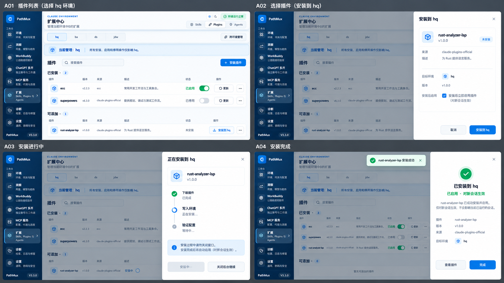

|编号|界面/状态|行为与结果|后续分支|
|---|---|---|---|
|A01|插件列表|hq 是明确的操作范围；安装、启停、维护均以当前环境为默认目标。|安装到 hq → A02 停用 ecc → A05 查看详情 → A06 跨环境管理 → A10 卸载 → A13 搜索无结果 → A15 切换新环境 → A16|
|A02|选择插件|安装抽屉显示来源、版本、目标 hq 和安装后是否启用；提交前取消不改变配置。|安装到 hq → A03 取消 → A01|
|A03|安装进行中|区分下载、写入、验证阶段；验证通过前不显示已启用。关闭抽屉后任务在后台继续。|安装验证通过 → A04 后台继续 → A01|
|A04|安装完成|rust-analyzer-lsp 进入已安装区；明确已启用、对新会话生效。|完成 → A01 查看插件 → A06|

### 启停与更新（A05—A08）

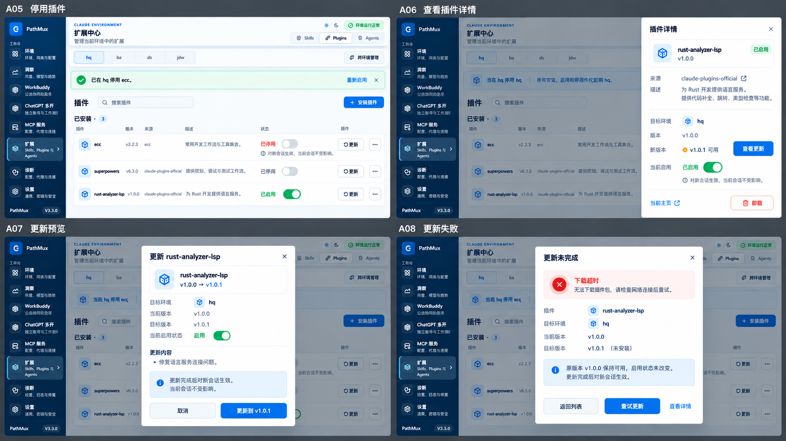

|编号|界面/状态|行为与结果|后续分支|
|---|---|---|---|
|A05|停用插件|ecc 仅在 hq 停用；保留重新启用入口。当前运行会话保持原状。|重新启用 → A01 查看其他插件 → A06|
|A06|查看插件详情|展示当前环境的实际版本、来源、启用状态和可更新版本。|查看更新 → A07 卸载 → A13 关闭 → A01|
|A07|更新预览|核对当前版本、目标版本、启用状态和生效时机；范围仅 hq。|确认更新（失败分支） → A08 确认更新（成功分支） → A09 取消 → A06|
|A08|更新失败|展示失败原因；原版本 v1.0.0 与启用状态保持可用。不会显示目标版本已安装。|重试成功 → A09 返回列表 → A01 修改后重试 → A07|

### 更新恢复与复制配置（A09—A12）

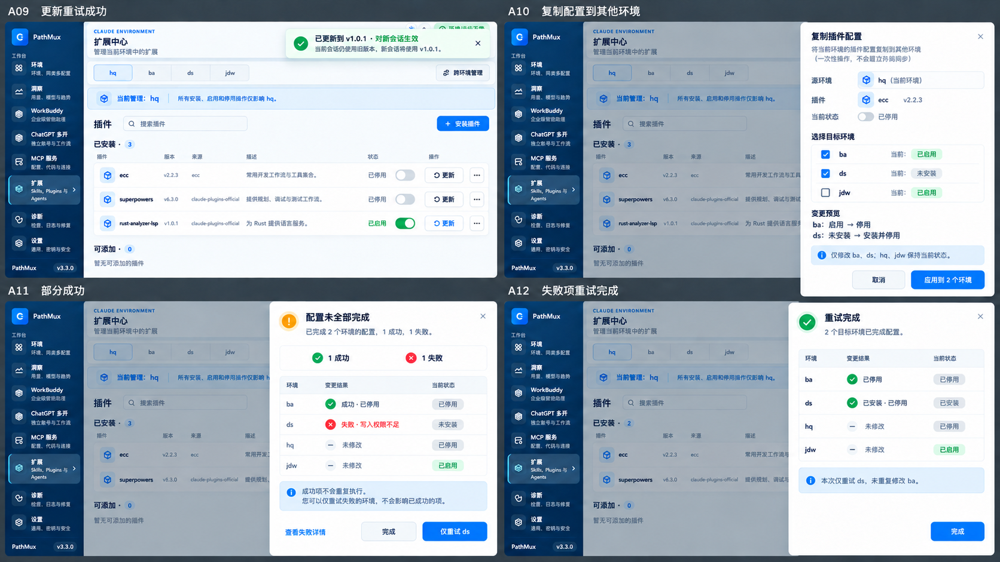

|编号|界面/状态|行为与结果|后续分支|
|---|---|---|---|
|A09|更新重试成功|验证成功后显示实际版本 v1.0.1，原会话继续使用原状态。|复制到其他环境 → A10 查看详情 → A06|
|A10|复制配置到其他环境|以 hq 的 ecc 停用状态为来源。ba 由启用变停用；ds 安装并停用；hq、jdw 不变。|应用（部分失败） → A11 应用（全部成功） → A12 取消 → A01|
|A11|部分成功|ba 成功，ds 因写入权限失败且仍未安装。成功项不会重复执行。|仅重试 ds → A12 完成并稍后处理 → A01|
|A12|失败项重试完成|只重试 ds；核对 ba、ds 最终状态，说明 hq、jdw 未修改。|完成 → A01|

### 卸载与空状态（A13—A16）

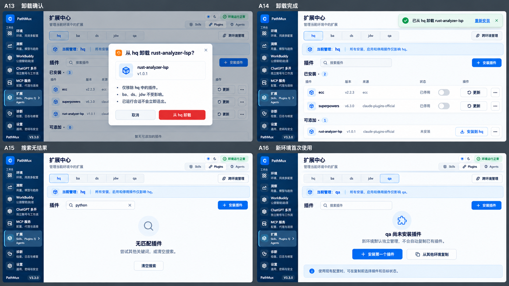

|编号|界面/状态|行为与结果|后续分支|
|---|---|---|---|
|A13|卸载确认|仅从 hq 卸载选中的插件；按钮写明环境。取消无副作用。|从 hq 卸载 → A14 取消 → A06|
|A14|卸载完成|插件回到可添加区，提供重新安装入口；不承诺瞬间撤销卸载。|重新安装 → A02 继续管理 → A01|
|A15|搜索无结果|保留环境上下文和安装入口；无结果只表示当前筛选没有匹配。|清空搜索 → A01 安装插件 → A02|
|A16|新环境首次使用|qa 默认独立管理且无插件。提供安装第一个插件、从其他环境复制两条路径。|安装第一个插件 → A02 从其他环境复制 → A10|

## B · 跨环境批量管理

通过环境对照表定位差异，选择目标、预览变更并核对逐环境结果。

### 安装与执行（B01—B04）

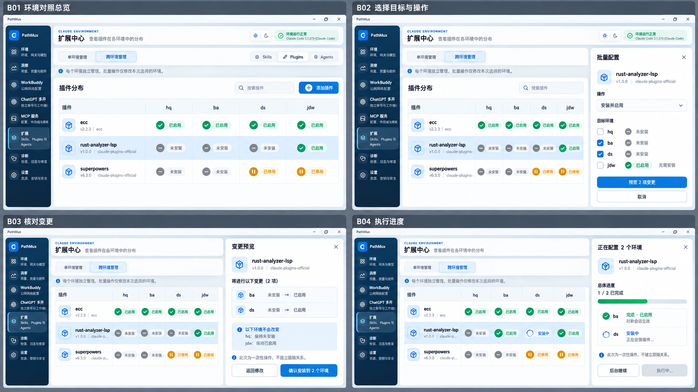

|编号|界面/状态|行为与结果|后续分支|
|---|---|---|---|
|B01|环境对照总览|一次比较插件在 hq、ba、ds、jdw 的安装、启停状态；选择插件后配置。|批量配置 rust → B02 查看版本 → B08 搜索无结果 → B16|
|B02|选择目标与操作|安装并启用 rust，选择 ba、ds；已安装的 jdw 不重复安装。|预览变更 → B03 取消 → B01|
|B03|核对变更|逐项显示 ba、ds 从未安装到启用；明确 hq、jdw 不变。|确认安装 → B04 返回修改 → B02 取消 → B01|
|B04|执行进度|ba 完成、ds 安装中；对照表展示实际执行进度。关闭面板不终止后台任务。|执行完成 → B05 后台继续 → B01|

### 结果与批量启停（B05—B08）

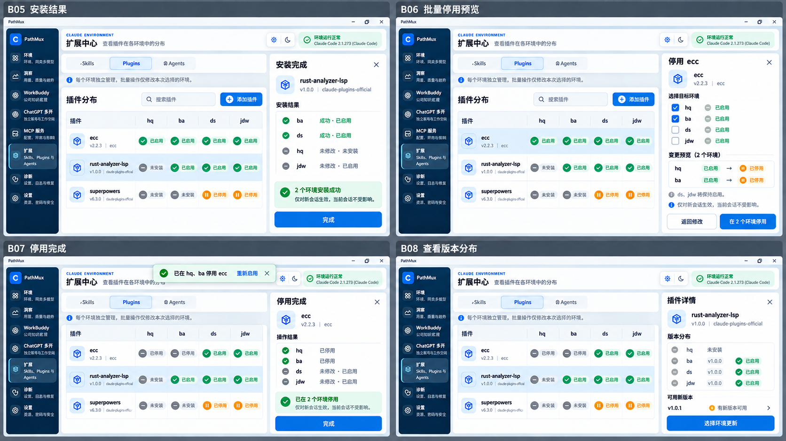

|编号|界面/状态|行为与结果|后续分支|
|---|---|---|---|
|B05|安装结果|按环境核对成功与未修改项；rust 只新增到 ba、ds。|完成 → B01 配置 ecc → B06|
|B06|批量停用预览|只停用 hq、ba 的 ecc，ds、jdw 保持启用；说明新会话生效。|在两个环境停用 → B07 返回修改 → B02 取消 → B01|
|B07|停用完成|矩阵立即反映 hq、ba 停用；重新启用入口带回相同目标，重新核对。|重新启用（返回预览） → B06 查看版本 → B08 完成 → B01|
|B08|查看版本分布|逐环境显示实际版本；未安装的环境不具有可更新版本。|选择环境更新 → B09 关闭 → B01|

### 更新失败与重试（B09—B12）

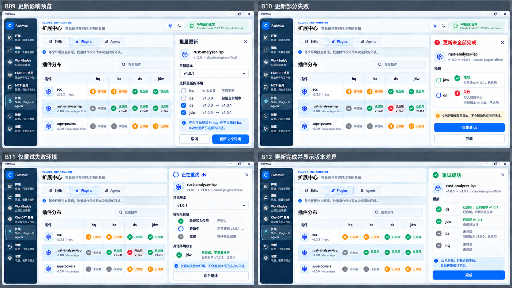

|编号|界面/状态|行为与结果|后续分支|
|---|---|---|---|
|B09|更新影响预览|只更新 ds、jdw 至 v1.0.1；ba 保留旧版，hq 不会被顺带安装。|确认更新 → B10 取消 → B08|
|B10|更新部分失败|jdw 更新成功；ds 失败仍使用旧版；展示实际版本与失败原因。|仅重试 ds → B11 稍后处理 → B01|
|B11|仅重试失败环境|重新验证 ds 的写入条件，已成功的 jdw 不重复更新。|重试成功 → B12 后台继续 → B01|
|B12|更新完成并显示版本差异|ds、jdw 为 v1.0.1；ba 为 v1.0.0；hq 未安装。差异是清楚可见的结果。|完成 → B01 卸载 ds → B13|

### 卸载与异常恢复（B13—B16）

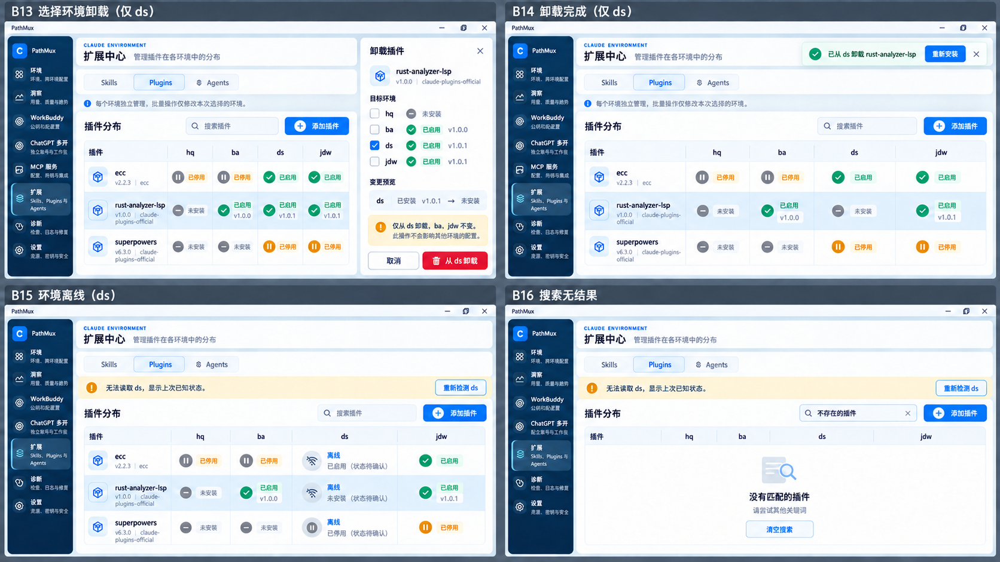

|编号|界面/状态|行为与结果|后续分支|
|---|---|---|---|
|B13|指定环境卸载确认|仅卸载 ds 的 rust；ba、jdw 的安装和版本不变。|从 ds 卸载 → B14 取消 → B01|
|B14|卸载结果|矩阵显示 ds 已未安装，保留重新安装入口并核对其他环境。|重新安装（目标 ds） → B02 完成 → B01|
|B15|环境暂时不可访问|ds 显示上次已知状态和待确认标记，阻止向 ds 写入；其他环境可用。|重新检测成功 → B01 重新检测失败 → B15 搜索 → B16|
|B16|搜索与恢复入口|空结果只替换列表内容，离线提示和重新检测入口保留。|清空搜索 → B15 恢复连接 → B01|

## C · 公共配置与环境例外

明确公共期望、实际状态与管理来源，长期同步并允许逐插件例外。

### 公共添加与同步（C01—C04）

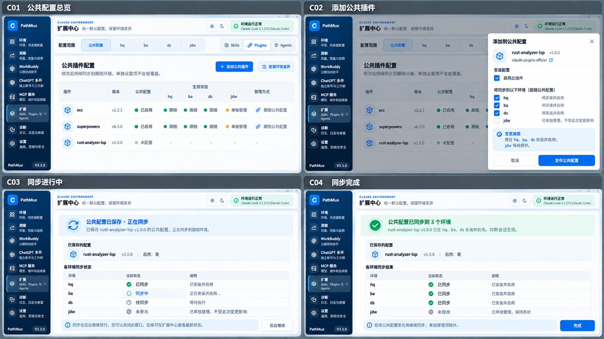

|编号|界面/状态|行为与结果|后续分支|
|---|---|---|---|
|C01|公共配置总览|公共配置是一条持续规则；按插件明确跟随环境与独立项。|添加公共插件 → C02 查看 hq 例外 → C05 公共更新 → C09 公共移除 → C13 接入新环境 → C15|
|C02|添加公共插件|预览新增 rust 对 hq、ba、ds 的影响；独立管理的 jdw 明确排除。|发布公共配置 → C03 取消 → C01|
|C03|同步进行中|先保存公共期望，再逐环境执行；已保存不等于已全部同步。|全部完成 → C04 部分失败（沿用偏差处理） → C10 后台继续 → C01|
|C04|同步完成|逐环境结果显示三项已同步，jdw 未修改；后续继续跟随公共规则。|完成 → C01 为 hq 单独设置 → C05|

### 单独设置与恢复跟随（C05—C08）

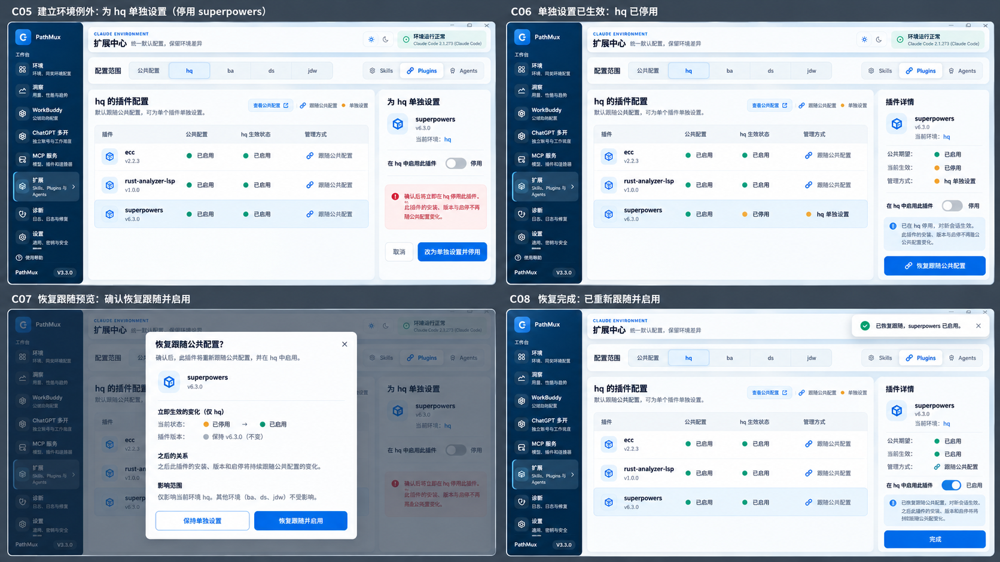

|编号|界面/状态|行为与结果|后续分支|
|---|---|---|---|
|C05|建立环境例外|确认将 hq 的 superpowers 改为单独管理并停用；安装、版本、启停均退出自动覆盖。|改为单独设置并停用 → C06 取消 → C01|
|C06|单独设置已生效|同时展示公共期望启用、hq 实际停用、管理来源为单独设置。例外不是同步错误。|恢复跟随公共配置 → C07 返回 → C01|
|C07|恢复跟随预览|分开说明立即变化与未来关系：现在启用，之后持续跟随安装、版本和启停。|恢复跟随并启用 → C08 保持单独设置 → C06|
|C08|恢复完成|管理来源恢复为跟随公共配置；关系由明确标记表达，不由状态相同推断。|完成 → C01|

### 更新偏差与修复（C09—C12）

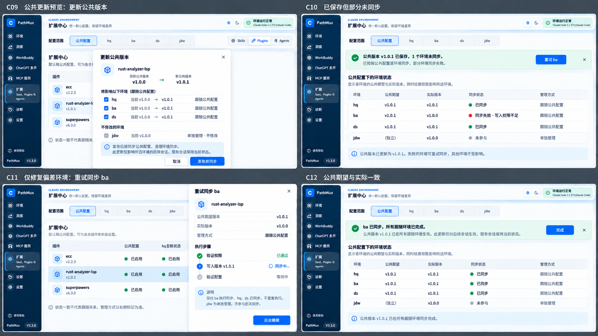

|编号|界面/状态|行为与结果|后续分支|
|---|---|---|---|
|C09|公共更新预览|公共目标从 v1.0.0 改为 v1.0.1；只同步跟随项，独立项明确排除。|发布并同步 → C10 取消 → C01|
|C10|已保存但部分未同步|公共期望 v1.0.1 已保存，ba 实际仍为 v1.0.0。失败不会自动变成独立管理。|重试 ba → C11 稍后处理 → C01|
|C11|仅修复偏差环境|只重试 ba，保留其跟随关系；hq、ds 不重复执行，jdw 不参与。|重试成功 → C12 后台继续 → C01|
|C12|公共期望与实际一致|全部跟随项为 v1.0.1；jdw 独立旧版本保留，且不被误报为失败。|完成 → C01|

### 移除与新环境接入（C13—C16）

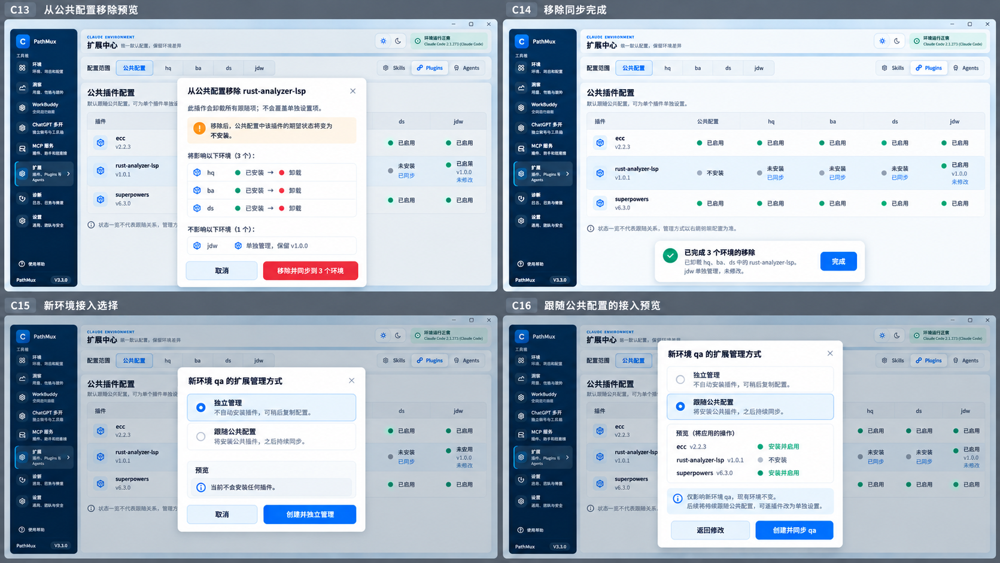

|编号|界面/状态|行为与结果|后续分支|
|---|---|---|---|
|C13|从公共配置移除预览|公共期望变为不安装；跟随项将卸载，独立项不变。移除保留明确的不安装规则。|移除并同步 → C14 取消 → C01|
|C14|移除同步完成|hq、ba、ds 未安装且已同步；jdw 独立安装保留。|完成 → C01 接入新环境 → C15|
|C15|新环境接入选择|qa 默认独立管理，不自动安装；用户可明确选择跟随公共配置。|选择跟随公共配置 → C16 创建并独立管理 → A16 取消 → C01|
|C16|跟随公共配置的接入预览|预览 qa 将安装启用 ecc、superpowers，rust 不安装；现有环境不变。|创建并同步 qa → C03 返回修改 → C15 完成后的状态复用 → C04|

